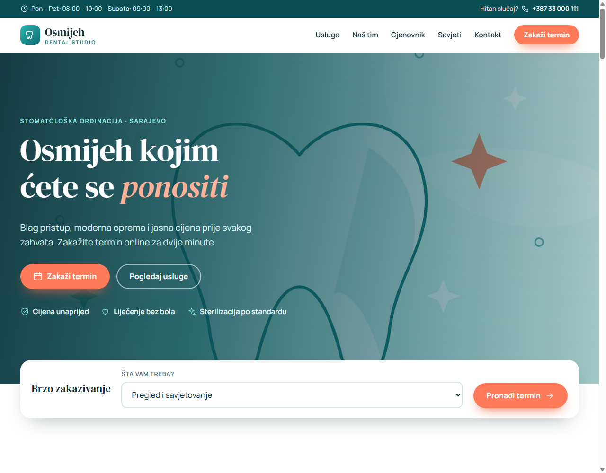
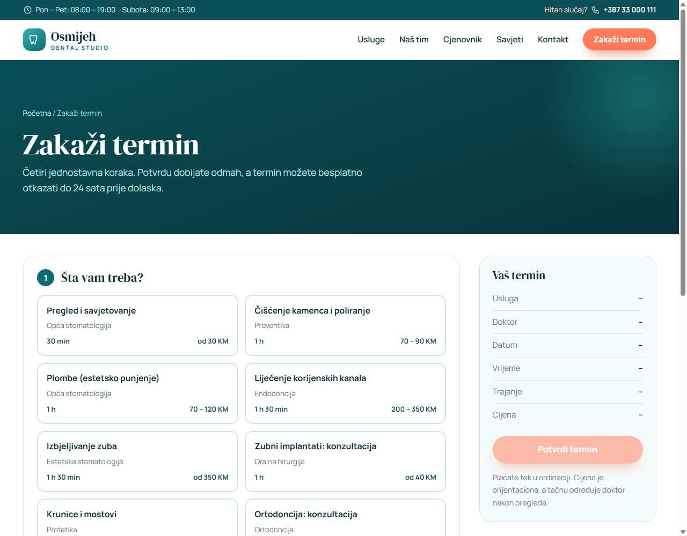
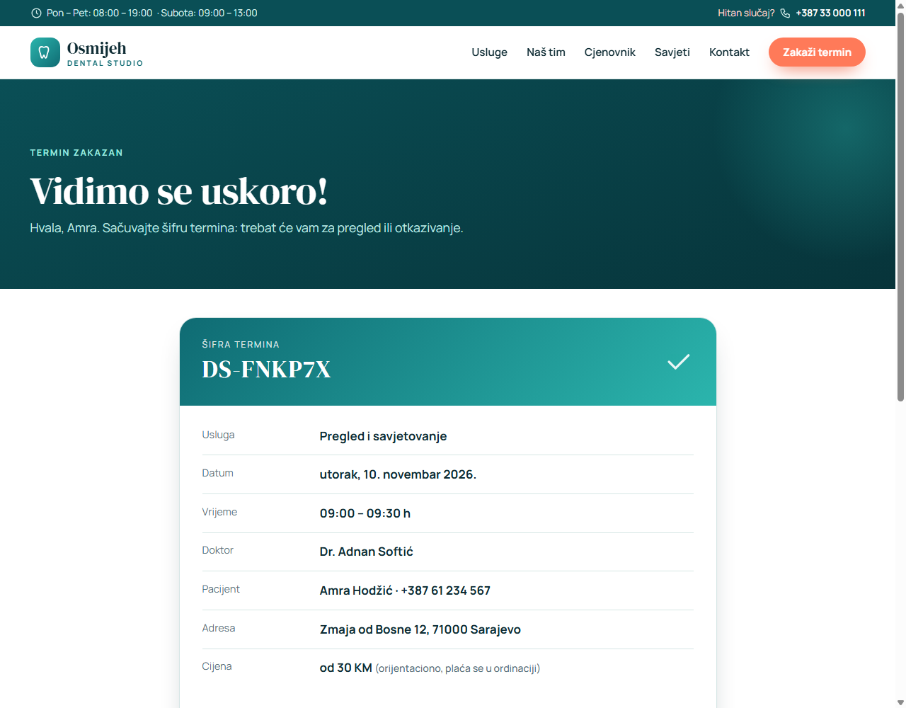
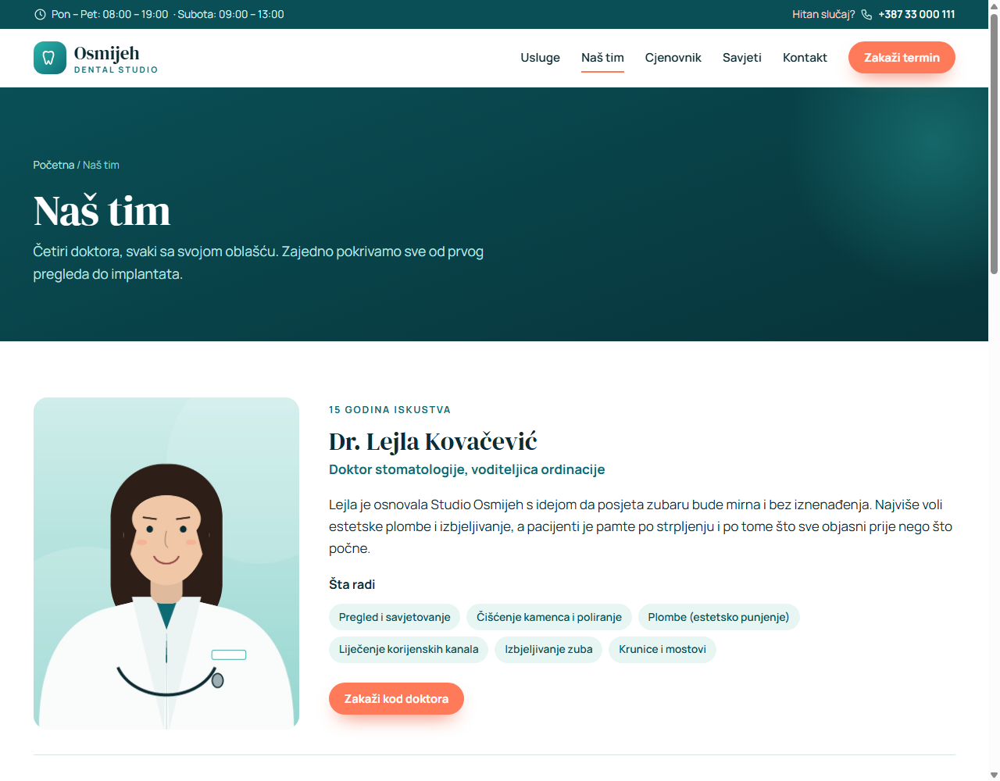
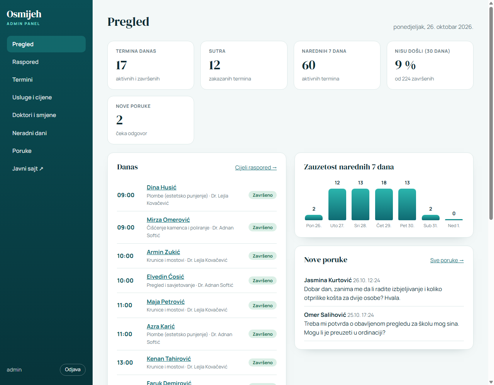

# Dental Studio Osmijeh

[](https://github.com/Emir0404/DentalClinic/actions/workflows/ci.yml)

A complete website for a (fictional) dental clinic with **online appointment booking** and a full admin panel.
ASP.NET Core 10 MVC, EF Core and SQLite. The site is in Bosnian, the code and this documentation are in English.
All names, prices and the address are made up; the footer says so.



## Features

**Patients**
- Home page, 11 services with details, price list, the team of 4 doctors, 7 advice articles, FAQ, contact form, privacy page
- **Online booking in four steps**: service, doctor (or "first free"), a day from a calendar that shows how many times are free,
  a time, then contact details. Made to work well on phones too.
- Confirmation page with a calendar file, cancelling until 24 hours before, and "find my appointment" (code + e-mail)
- SEO: sitemap, robots, structured data (JSON-LD), clean addresses

**Clinic staff (admin)**
- Dashboard (today, next days, new messages), day schedule per doctor
- Appointments: search and filters, status (confirmed, completed, no-show, cancelled), internal notes, CSV export
- Services: add, edit, hide, delete only when never booked. Doctors: add with photo, working shifts, deactivate with a warning
  about future appointments. Days off for the clinic or one doctor. Messages from the contact form.

| Booking | Confirmation |
|---|---|
|  |  |

| Team | Admin |
|---|---|
|  |  |

## The interesting engineering

- **The scheduling rules are one pure function** (`SlotFinder`): working shifts, existing appointments, lunch breaks
  between shifts, slots of 30 minutes, at least 2 hours ahead and at most 60 days. No database or web code inside,
  so it has its own test suite. "First free doctor" balances by the number of appointments that day.
- **No double booking.** Free times are re-checked inside a lock at the moment of saving, never trusting what the browser
  showed a minute earlier. A test fires eight simultaneous requests for one slot and expects exactly one appointment.
  *(An in-process lock suits one server; several servers would need a database-level rule.)*
- **A patient's own pages open with a 128-bit random token**, not with the short code. The code (`DS-K7M2PQ`) is only for
  saying aloud to the clinic; guessing codes opens nothing, and "find my appointment" needs the code *and* the e-mail.
- **Abuse limits.** Rate limits per address on booking and contact (they share one limit), lookup/cancel, the booking
  form's data and the admin login (`429` + `Retry-After`). One e-mail or phone can hold at most 3 upcoming appointments,
  so nobody can reserve the whole calendar.
- **Security basics:** anti-forgery token on every POST (global filter), a Content-Security-Policy with **no inline scripts**
  (a test scans every page for inline handlers), admin credentials only from configuration (admin off when unset) compared
  in constant time, CSV export protected against formula injection, uploaded photos verified by their content (not their
  file name or declared type), at most 4 MB, saved under server-made names.
- **History is never deleted.** Appointments are cancelled, not removed; a service or doctor with appointments can only be
  deactivated.
- **Real migrations** with an upgrade path for old databases (one made by an earlier `EnsureCreated` version is adopted
  and upgraded without losing data), covered by tests.
- **Time is injected** (`TimeProvider`), so rules like "cancel until 24 hours before" are tested with a fixed clock.
- **No photos of real people.** The four doctors, the home page and the children's pictures are original illustrations
  (`tools/generate-illustrations.py`), see [IMAGE-CREDITS.md](IMAGE-CREDITS.md).

## Run it

Requires the [.NET 10 SDK](https://dotnet.microsoft.com/download). In Visual Studio press **F5**, or:

```bash
dotnet run --project src/DentalClinic
```

The database is built through the migrations and filled with services, doctors and articles on first start.
For sample appointments set `SeedDemoData=true` (done in `Development`). The admin panel is at `/admin`; in `Development`
the credentials are `admin` / `admin123`. In production **nothing is set** and the admin is off until you provide them:

```bash
dotnet user-secrets set "Admin:Username" "owner" --project src/DentalClinic
dotnet user-secrets set "Admin:Password" "a long secret" --project src/DentalClinic
```

```bash
dotnet test        # 216 tests
```

### Docker

```bash
docker build -t dentalclinic .
docker run -p 8080:8080 -v clinic-data:/data -v clinic-photos:/app/wwwroot/img/uploads \
  -e Admin__Username=owner -e Admin__Password='a long secret' dentalclinic
```

### Configuration

| Setting | Default | Meaning |
|---|---|---|
| `ConnectionStrings:Clinic` | `Data Source=clinic.db` | SQLite file |
| `Admin:Username` / `Admin:Password` | empty = admin off | Admin login |
| `SeedDemoData` | false | Sample appointments |
| `RateLimit:SubmitPer10Minutes` | 8 | Bookings and contact messages per address |
| `RateLimit:LookupPer10Minutes` | 20 | "Find my appointment" and cancel per address |
| `RateLimit:LoginPerMinute` | 8 | Admin login attempts per address |
| `RateLimit:ReadPerMinute` | 120 | The free days and times the booking form loads |
| `DataProtection:KeysPath` | none | Where login cookie keys are kept (set it in containers) |
| `HttpsRedirection` | true outside Development | `false` behind a proxy that handles https |

## Tests (216)

Free-time calculation, booking rules and simultaneous requests, cancelling and statuses, the whole booking journey over HTTP,
the admin panel (services, doctors, shifts, days off, photo upload validation), CSV and calendar files, **access tokens and
guessing**, **rate limits**, the per-contact cap, CSP and "no inline script" checks, migrations (fresh, upgrade, adoption).

## Known limits (deliberate)

- E-mails and text messages are not sent (there is no mail server in the demo).
- Patient data is personal data: a real deployment needs a retention rule, backups and a data-processing agreement.
- 23 of the Unsplash photos remain; see [IMAGE-CREDITS.md](IMAGE-CREDITS.md) (photographers are still to be looked up).
- One server: the booking lock is in-process.

## Tech

C# · ASP.NET Core 10 MVC · EF Core + SQLite (migrations) · xUnit · Docker · GitHub Actions
